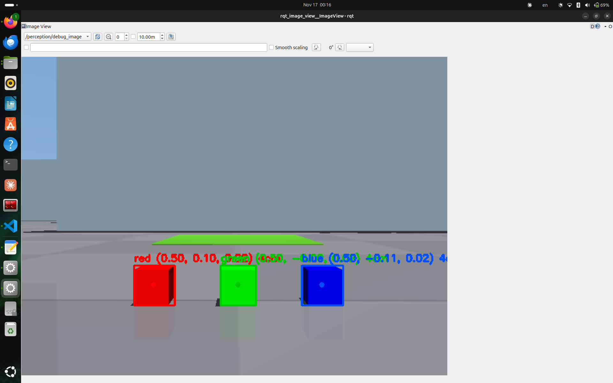

# moment_perception: test results

All tests in MuJoCo (`mujoco_ros2_control`), ROS 2 Jazzy, team camera (640x480, fovy 49°, fx = 526.6).
Scene: `moment_mujoco/models/moment_perception_test_scene.xml` (static warehouse + test objects).
Robot at the world origin facing +x, so `base_footprint` coordinates = world coordinates.
Cubes: 4 cm. z is not measured: it is set to cube_size/2 because cubes rest on the floor.

## Run 1: baseline (no size gate), 2026-11-16

| Object | True (x, y) | Detected (x, y, z) | Error | Result |
|---|---|---|---|---|
| red cube | 0.50, 0.10 | 0.4991, 0.1016, 0.0200 | 1.9 mm | ✅ |
| blue cube | 0.50, −0.10 | 0.4991, −0.1016, 0.0200 | 1.9 mm | ✅ |
| green cube | 0.50, 0.00 | 1.4842, 0.0011, 0.0200 | **0.98 m** | ❌ green floor patch chosen |

**Finding:** the warehouse bays use the same colours as the cubes (red_pad H≈174, green_pad H≈49,
blue_pad H≈105 in OpenCV HSV, all inside the detector's ranges). The detector keeps the *largest*
blob per colour, and a floor zone seen from 1–2 m has more pixels than a cube at 0.5 m
(here ≈2,600 px vs ≈1,900 px), so the zone wins. In the mission the robot looks at the bays to
deliver, so this would report a bay as a cube.

**Fix planned:** reject blobs whose physical size (from depth) is not cube-like.

## Run 2: size gate (min 1.5 cm, max 8 cm), 2026-11-17

Same scene. Blobs are now tried largest first; the first with a physical size of 1.5–8 cm wins.

| Object | True (x, y) | Detected (x, y, z) | Error | Result |
|---|---|---|---|---|
| red cube | 0.50, 0.10 | 0.4989, 0.0975, 0.0200 | 2.7 mm | ✅ |
| green cube | 0.50, 0.00 | 0.4988, −0.0037, 0.0200 | 3.9 mm | ✅ (was 0.98 m in Run 1) |
| blue cube | 0.50, −0.10 | 0.4976, −0.1053, 0.0200 | 5.8 mm | ✅ |

The floor patch (≈0.5 m measured size) is rejected; the cube (≈4 cm) is accepted.
All three y values are ≈4 mm low by the same amount, which points to a small robot pose offset
rather than a detection error. Every error is inside the gripper's ±17 mm margin for a 4 cm cube.

